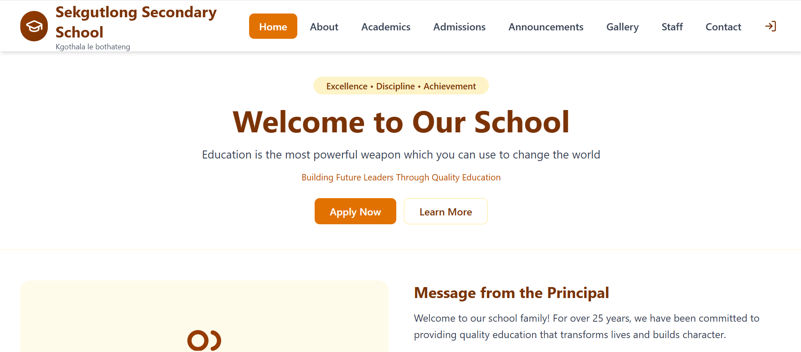
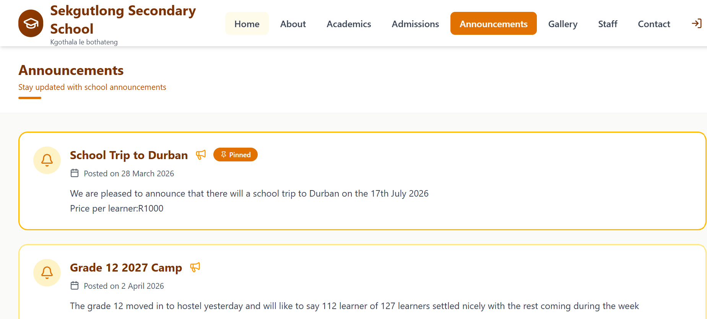
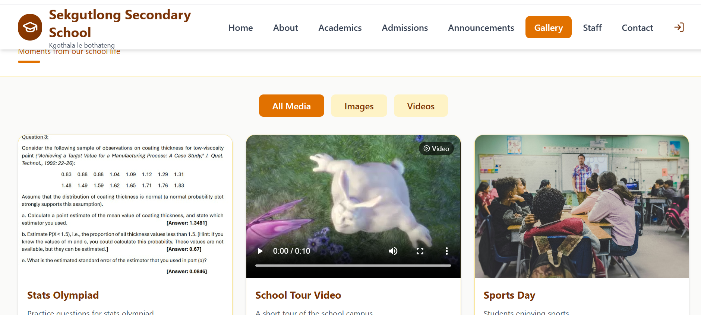
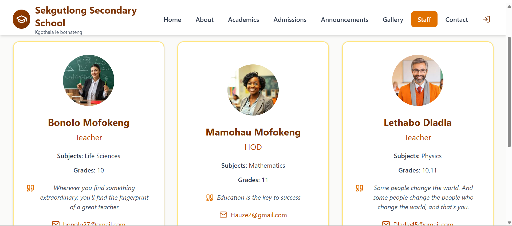
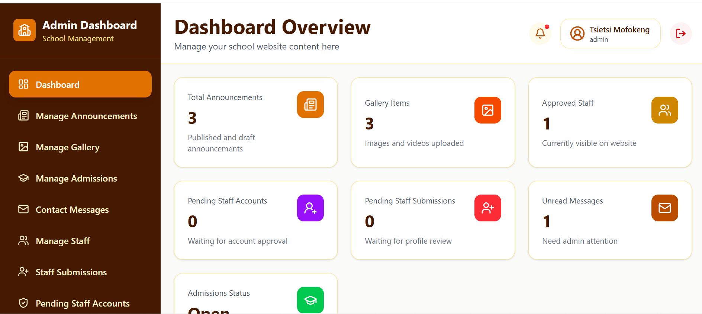
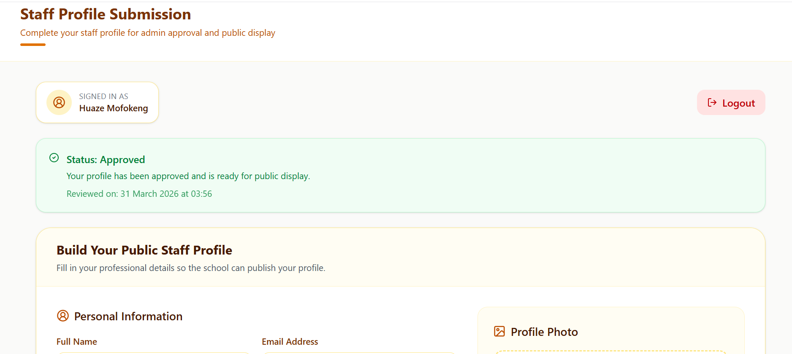

# 🎓 Sekgutlong School Website & Management System

<p align="center">
  A modern full-stack platform designed to support real school operations, staff workflows, and public engagement.
</p>

<p align="center">
  
  
  
  
  
</p>

---

## 🚀 Overview

The **Sekgutlong School Website & Management System** is a full-stack web application designed to streamline school operations while providing a clean and interactive public-facing platform.

It bridges the gap between **administration, staff, and the public**, enabling efficient communication, content management, and workflow automation.

---

## 🌍 Real-World Impact

This system was designed with the goal of being **deployed and used by Sekgutlong School** to improve administrative efficiency and communication.

It addresses real challenges such as:

- Managing announcements in one place
- Streamlining staff profile submissions and approvals
- Providing a centralized platform for students, parents, and staff

This project demonstrates how software can be used to **solve practical problems in educational environments**.

---

## ✨ Key Features

### 🌐 Public Platform

- 📢 View announcements and updates
- 🖼️ Browse media gallery (images & videos)
- 👩‍🏫 Explore staff profiles
- 📝 Access admissions information
- 📩 Contact the school

### 🔐 Admin Dashboard

- 🔑 Role-based access (admin, staff, pending staff) enforced with Supabase Row Level Security
- 🛠️ Full CRUD for announcements
- 🖼️ Manage gallery content
- 👥 Staff management system
- ✅ Approve/reject staff submissions
- 📬 Manage contact messages
- 📊 Dashboard statistics and insights

### 👩‍🏫 Staff System

- 📝 Staff profile submission workflow
- ⏳ Admin approval system (pending / approved / rejected)
- 🖼️ Profile image upload with preview
- 📍 Status tracking system

---

## 🛠️ Tech Stack

| Layer      | Technology                                             |
| ---------- | ------------------------------------------------------ |
| Frontend   | React (Vite), Tailwind CSS                             |
| Backend    | Supabase (Database, Auth, Storage, Row Level Security) |
| UI/UX      | Lucide React Icons                                     |
| Tools      | React Hot Toast                                        |
| Testing    | Vitest, React Testing Library                          |
| CI         | GitHub Actions                                         |
| Versioning | Git & GitHub                                           |

---

## 📸 Screenshots

### 🏠 Home Page

<p align="center">
  
</p>

### 📢 Announcements

<p align="center">
  
</p>

### 🖼️ Gallery

<p align="center">
  
</p>

### 👩‍🏫 Staff Page

<p align="center">
  
</p>

### 🧑‍💼 Admin Dashboard

<p align="center">
  
</p>

### 📝 Staff Profile Submission

<p align="center">
  
</p>

---

## ⚙️ Installation & Setup

```bash
git clone https://github.com/Tsiika165/sekgutlong-school-website.git
cd sekgutlong-school-website
npm install
```

Create a `.env` file in the project root (see `.env.example`):

```
VITE_SUPABASE_URL=your-project-url
VITE_SUPABASE_ANON_KEY=your-supabase-anon-key
VITE_STAFF_ACCESS_CODE=choose-a-code
```

Then start the app:

```bash
npm run dev
```

---

## 🔐 Database Security

Access control is enforced in the database with Supabase Row Level Security, not only in the UI.

| Data                                         | Who can read              | Who can write                                                   |
| -------------------------------------------- | ------------------------- | --------------------------------------------------------------- |
| News (published), gallery, staff, admissions | Everyone                  | Admins only                                                     |
| Contact messages                             | Admins only               | Anyone can send                                                 |
| Staff submissions                            | Own submission, or admins | Approved staff (own row), admins                                |
| Profiles                                     | Own profile, or admins    | New sign-ups start as `pending_staff`; only admins change roles |
| Storage (`news-media`)                       | Everyone                  | Upload: staff and admins. Delete: admins                        |

To set up your own Supabase project, run these in the SQL editor, in order:

1. `supabase/security-policies.sql`
2. `supabase/storage-policies.sql`

Login by phone number uses the `email_for_phone` database function, which the first script creates.

---

## 🧪 Testing & CI

Unit tests use [Vitest](https://vitest.dev) and React Testing Library, with the Supabase client mocked.

```bash
npm test          # watch mode
npm run test:run  # single run (used in CI)
```

Covered so far: login (email and phone lookup, error paths), staff sign-up (access code gate, `pending_staff` role), role-based page access in `App`, navigation, and shared UI components. GitHub Actions runs lint, tests and a production build on every push.

---

## 🚀 Deployment

- **Live demo (Vercel):** https://sekgutlong.vercel.app
- **GitHub Pages (optional, currently disabled):** a deploy workflow is included in `.github/workflows/deploy-pages.yml`. To enable it, set Pages source to "GitHub Actions" and add `VITE_SUPABASE_URL`, `VITE_SUPABASE_ANON_KEY` and `VITE_STAFF_ACCESS_CODE` as repository secrets.

---

## 🌐 Future Improvements

- 🏫 Integrate Sekgutlong School branding and visuals for improved user experience
- 🎨 Enhance UI/UX by incorporating real images of Sekgutlong School
- 🖼️ Add a dynamic background featuring Sekgutlong School
- 🔒 Move staff access-code validation to the server (it currently ships in the client bundle)
- 🧪 Expand test coverage to the admin pages and the staff profile form
- 📱 Mobile application version for broader accessibility
- 🔔 Real-time notifications for announcements and updates
- 📈 Advanced analytics dashboard for admin insights
- 🧠 AI-powered search and recommendations
- 🌍 Multi-language support for inclusivity

---

## 🤝 Contribution

Contributions are welcome!

1. Fork the repository
2. Create your feature branch
3. Commit your changes
4. Open a pull request

---

## 📄 License

This project is open-source and available under the MIT License.

---

## 👨‍💻 Author

**Tsietsi Mofokeng**

- 💼 Aspiring Software Engineer & Systems Developer
- 🎓 BSc Computer Science & Information Systems
- 🌍 Passionate about building real-world digital solutions

> This project is part of my portfolio showcasing full-stack development, system design, and real-world problem solving.

---

<p align="center">
  ⭐ If you like this project, consider giving it a star!
</p>
